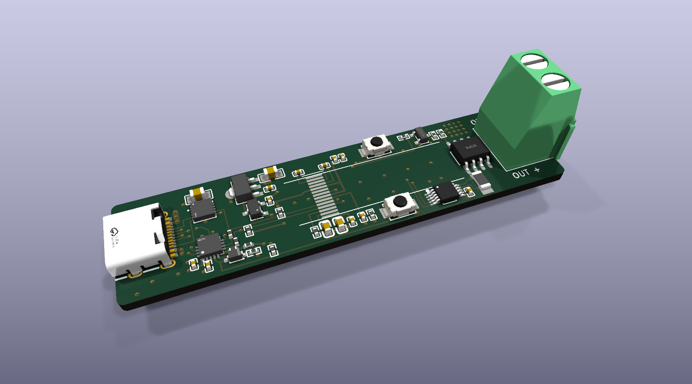
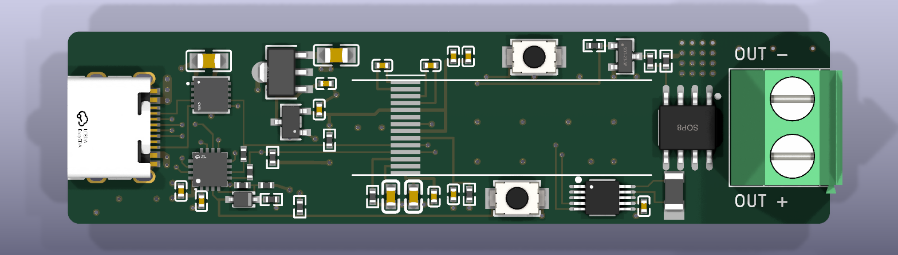

# usb-pd

A small USB-C Power Delivery trigger board. Plug it into a PD charger, pick a voltage with a button, switch the
output on and off, and read volts, amps, watts and board temperature on a tiny OLED.





*KiCad 3D renders. The 0.69" OLED glass sits over the middle of the board on its hand-soldered flex cable; it has
no 3D model, so only its pads show.*

## What it does

- Negotiates 5, 9, 12, 15, 18 or 20 V from a USB-PD charger (HUSB238 sink), and never requests a voltage the
  charger does not offer.
- **CYCLE** steps through the voltages the charger advertises. Cycling while the output is on turns it off first.
- **ON/OFF** switches the output through a P-MOSFET high-side switch (AO4407A).
- Shows the voltage, on/off state, output current and power (INA226 with a 5 mOhm Kelvin shunt) and board
  temperature (NTC), updated at 10 Hz.
- Remembers the last voltage and on/off state across power cycles, wear-levelled in the MCU's DataFlash.
- Turns the output off on over-temperature (board NTC plus a MOSFET temperature estimate) and when the load draws
  more than the charger's contract allows.
- Firmware updates over the same USB-C port (CH552 ROM bootloader).

## Hardware

- 67 x 17 mm, 2 layers, all parts on top, made for JLCPCB economic assembly.
- CH552P MCU, HUSB238 PD sink, INA226 power monitor, SGM2203 + XC6206 regulators.
- Output on two 5.08 mm through-hole pads (screw terminal or wires).
- Designed in KiCad 10 from scripts with [kicad-skills](https://github.com/jvanderberg/kicad-skills): the schematic,
  netlist, placement and routing are generated by `tools/` (`tools/build_board.sh`).

Read these before building one:
- [docs/requirements.md](docs/requirements.md): requirements, block diagram, parts and sourcing.
- [docs/design-review.md](docs/design-review.md): the design review, including its main limit. The board is small,
  so 100 W continuous makes it too hot; the firmware's thermal cutoff is what protects it.

## Firmware

C for SDCC, in [firmware/](firmware/). See [firmware/README.md](firmware/README.md).

```
cd firmware
make          # build/usbpd.hex and .bin
make test     # host tests
make flash    # wchisp, with the board in its bootloader
```

## Status

Designed, not yet built or tested. The board passes DRC, ERC and the design review, and the firmware passes its
host tests and simulator timing checks, but nothing has run on real hardware. This is a hobby project, not designed
or reviewed for safety-critical use.

Created in [T3 Code](https://t3.codes).
