# usb-pd

A small USB-C Power Delivery trigger board. Plug it into a PD charger, pick a voltage with a button, switch the
output on and off, and read volts, amps, watts and board temperature on a tiny OLED.

There are two boards, both 67 x 17 mm:
- **v1** (this page, top level): fixed PD voltages, HUSB238 sink.
- **[v2](#v2-pps-board)** (`v2/`): adds PPS, so any voltage from 5 to 21 V in 100 mV steps with a current limit.
  It is a pocket bench supply, built around the AP33772S.


*KiCad 3D renders. The 0.69" OLED is hand-soldered by its flex cable and folded over onto the board. Its model
(`tools/oled_3d.py`) is built from the panel's outline drawing and shows a real frame from the firmware.*

## The screen

What the firmware draws, rendered on the host from the real `ui_lines()` and `oled.c` code through a model of the
panel's memory, at the panel's pixel pitch (`cd firmware && make screens`):

| | |
|---|---|
| Output on: voltage, temperature, current, power |  |
| Output off: the charger's current limit at this voltage |  |
| No PD charger (plain 5 V) | 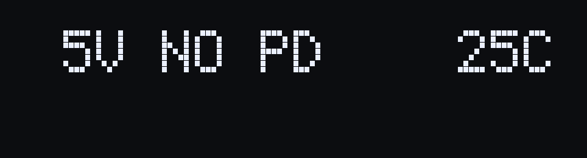 |
| Thermal cutoff | 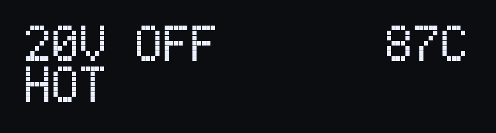 |
| Over-current trip (above the charger's contract) |  |

## What it does

- Negotiates 5, 9, 12, 15, 18 or 20 V from a USB-PD charger (HUSB238 sink), and never requests a voltage the
  charger does not offer.
- **CYCLE** steps through the voltages the charger advertises. Cycling while the output is on turns it off first.
- **ON/OFF** switches the output through a P-MOSFET high-side switch (AO4407A).
- Shows the voltage, on/off state, output current and power (INA226 with a 5 mOhm Kelvin shunt) and board
  temperature (NTC), updated at 10 Hz.
- Remembers the last voltage and on/off state across power cycles, wear-levelled in the MCU's DataFlash.
- Turns the output off on over-temperature (board NTC plus a MOSFET temperature estimate) and when the load draws
  more than the charger's contract allows.
- Firmware updates over the same USB-C port (CH552 ROM bootloader).

## Hardware

- 67 x 17 mm, 2 layers, all parts on top, made for JLCPCB economic assembly.
- CH552P MCU, HUSB238 PD sink, INA226 power monitor, SGM2203 + XC6206 regulators.
- Output on two 5.08 mm through-hole pads (screw terminal or wires).
- Designed in KiCad 10 from scripts with [kicad-skills](https://github.com/jvanderberg/kicad-skills): the schematic,
  netlist, placement and routing are generated by `tools/` (`tools/build_board.sh`).

Read these before building one:
- [docs/requirements.md](docs/requirements.md): requirements, block diagram, parts and sourcing.
- [docs/design-review.md](docs/design-review.md): the design review, including its main limit. The board is small,
  so 100 W continuous makes it too hot; the firmware's thermal cutoff is what protects it.

## Firmware

C for SDCC, in [firmware/](firmware/). See [firmware/README.md](firmware/README.md).

```
cd firmware
make          # build/usbpd.hex and .bin
make test     # host tests
make flash    # wchisp, with the board in its bootloader
```

## Status

Designed, not yet built or tested. The board passes DRC, ERC and the design review, and the firmware passes its
host tests and simulator timing checks, but nothing has run on real hardware. This is a hobby project, not designed
or reviewed for safety-critical use.

## v2 (PPS board)

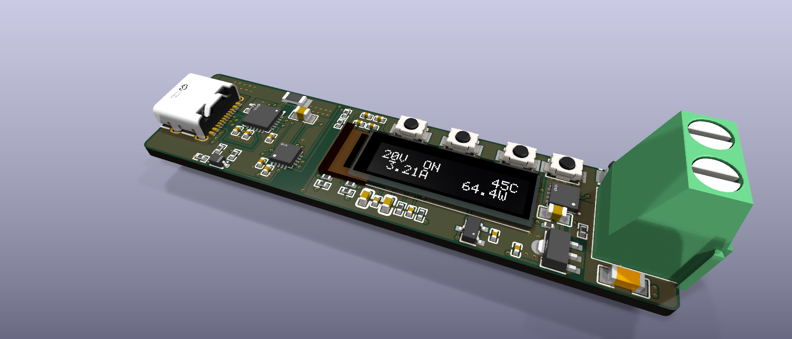

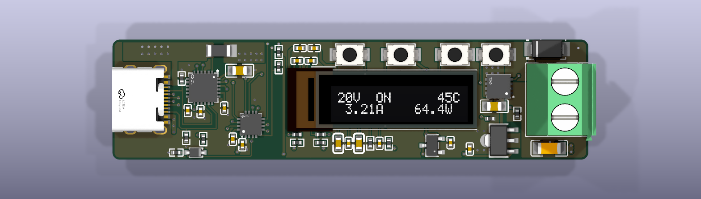

*KiCad 3D renders of `v2/hardware/usbpd2.kicad_pcb`. The OLED model still shows a v1 frame; the v2 screens are below.*

Same size and case style as v1. With a PPS charger it sets any voltage from 5 to 21 V in 100 mV steps, plus a
current limit, so it works as a small bench supply. With an ordinary PD charger it behaves like v1.

### The v2 screen

Rendered on the host from the v2 firmware (`cd v2/firmware && make screens`):

| | |
|---|---|
| PPS, output on: voltage, temperature, current, current limit |  |
| PPS, editing the voltage (`>` marks the value being edited) | 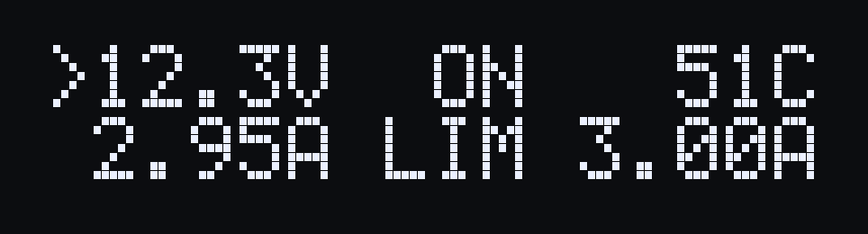 |
| PPS, editing the current limit (UP + DOWN switches) | 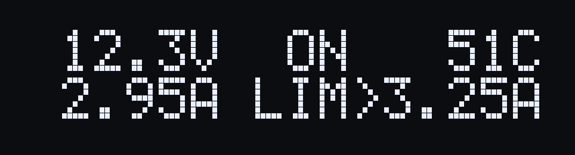 |
| PPS, charger hit its current limit and the voltage sagged (UVP trip) | 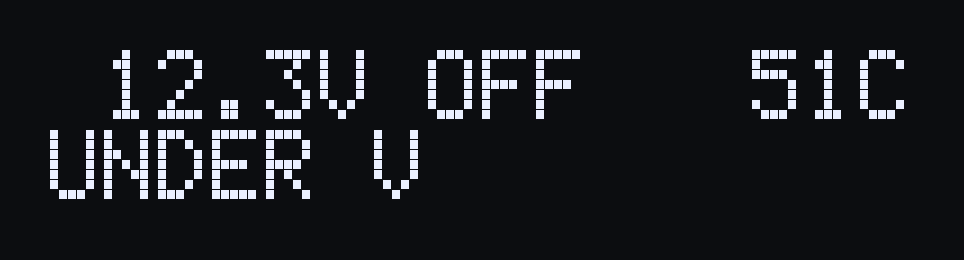 |
| Fixed voltage, output on | 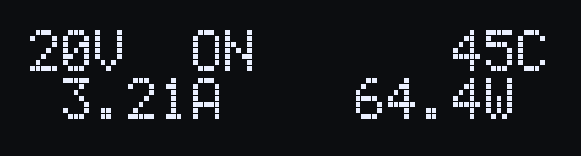 |
| Fixed voltage, output off | 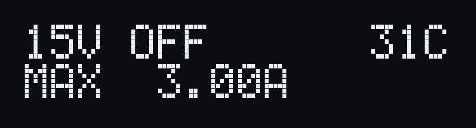 |
| No PD charger (plain 5 V) | 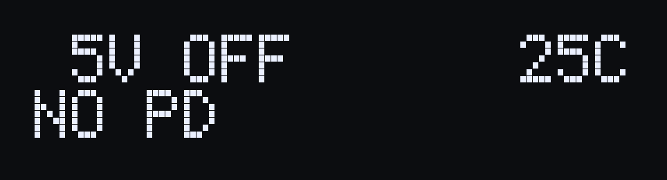 |
| Thermal cutoff |  |
| Over-current trip | 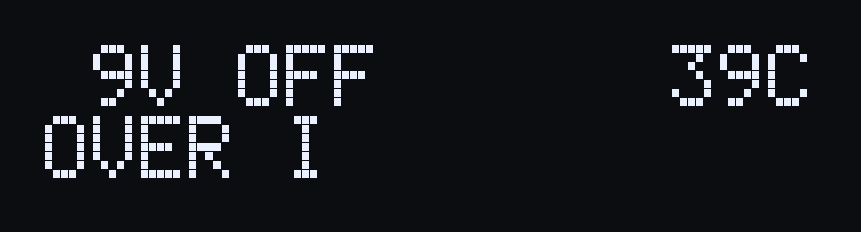 |

### What v2 changes

- **PD sink:** AP33772S (AP33772SDKZ-13-FA02) replaces the HUSB238. It negotiates fixed PDOs and PPS up to 21 V; EPR
  is disabled in firmware.
- **Buttons:** four, in one row: `[ON]  [SEL]  [UP][DN]`. SEL steps through the fixed voltages the charger offers,
  then PPS. In PPS, UP / DOWN change the setpoint (hold to accelerate) and UP + DOWN together switch between voltage
  and current limit.
- **Output switch:** one AON7262E N-MOSFET, driven by the AP33772S's own gate driver, with an SS34 clamp and 10 uF
  on the output (as CentyLab's RotoPD).
- **Measurement:** voltage, current and NTC temperature come from the AP33772S, so the INA226 is gone.
- **Protection:** the AP33772S's OCP / OVP / UVP / OTP, plus the firmware's own thermal trip.
- **MCU:** CH552P as before. It talks to the AP33772S on its own 5 V I2C bus and to the OLED on a 3.3 V bus.

### v2 files

- [docs/requirements-v2.md](docs/requirements-v2.md): requirements, decisions and parts.
- [v2/docs/design-review.md](v2/docs/design-review.md): the design review. As with v1, 100 W continuous makes the board too
  hot; the thermal trips protect it.
- [v2/firmware/README.md](v2/firmware/README.md): the v2 firmware (`make`, `make test`, `make screens`, `make flash`).
- `v2/tools/`: the scripts that generate the schematic and board (`v2/tools/build_board.sh`).
- `v2/production/`: JLCPCB gerbers, BOM and CPL for 10 boards. `v2/hardware/production/` is the same export for 5 boards.

### v2 status

Designed, not yet built. It passes DRC, ERC and the design review, and the firmware passes its host tests, but
nothing has run on hardware. Known open items before or at bring-up:
- **Firmware:** confirm that "output off" took effect by reading `SYSTEM` back, at boot and on every trip.
- **Bring-up:** measure Q1's gate drive and on-resistance, and check that JLC placed the polarised parts correctly.
- **Behaviour:** when a PPS charger hits its current limit, the output trips on undervoltage instead of holding a
  constant current.

Created in [T3 Code](https://t3.codes).
